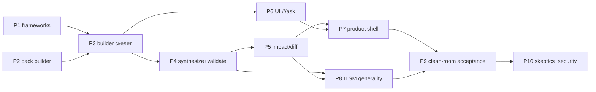
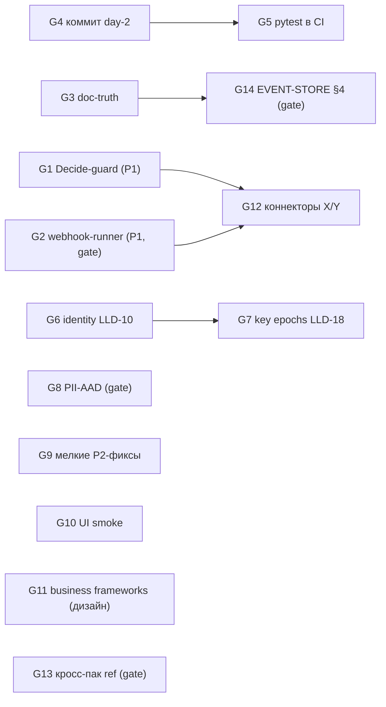

# DEVELOPMENT GRAPH — кандидаты работ с доказательствами

> Не roadmap-фантазия: каждый кандидат имеет evidence (файл:строка), desired outcome,
> зависимости, риск, blast radius, acceptance criteria, required reviewer и
> human-gate-метку. Актуализируется каждый цикл. Источник фактов: SYSTEM_TRUTH.md.

## ENGLISH-FIRST INDUSTRIAL RELEASE (активная миссия, scope-frozen)

> План: docs/forge/ENGLISH_RELEASE_PLAN.md. Три работы: egress hardening,
> English-first pass, финальная acceptance. Ревью Architect Pro: запущено.

### E1 · Egress: стабильная idempotency-identity + receipts + DLQ/recovery
- **Проблема**: ключ доставки = task id → requeue/DLQ-recovery рождает новый
  ключ → дубль business effect; нет per-attempt receipts, DLQ-листинга и
  ручного recovery.
- **Evidence**: webhooks.go:146 ("webhook:"+t.ID); tasks.go:288-306 (settle
  one-shot); automation.go:293 (TaskWebhook creation).
- **Desired outcome**: identity из бизнес-источника в taskPayload (стабильна
  через requeue); новый additive kind WebhookAttempt (receipts); листинг
  failed webhook tasks + RetryWebhookTask (та же identity, basis manual
  retry); CLI `kalita egress dlq|retry` + REST + UI DLQ; классификация
  retryable/non-retryable; метрики.
- **Deps**: нет. **Risk**: medium (журнал: новый kind). **Blast radius**:
  engine + cmd/kalita/webhooks.go + api + web.
- **Acceptance**: failure-injection A–H зелёные; replay/golden не сломаны;
  Skeptic+Security ACCEPT. **Reviewer**: architect_pro + security_pro.
  **Human gate**: нет.

### E2 · Egress: секреты через runtime injection
- **Проблема**: нет авторизации к destinations; нет защищённого места для
  секретов (запрет: DSL/prompt/journal/git).
- **Evidence**: webhooks.go deliverOnce (без Authorization).
- **Desired outcome**: KALITA_EGRESS_SECRETS → 0600-JSON {"domain": "Bearer
  …"} (в .gitignore); runner инжектит Authorization; missing → fail safely;
  payload/журнал без секретов; secret scan.
- **Deps**: E1. **Reviewer**: security_pro. **Human gate**: нет.

### E3 · English-first pass
- **Проблема**: product default — русский; релиз English-first.
- **Evidence**: web/app.js (~113 RU-строк), frameworks (~165), workers/builder
  (~303), egress.go (~20); языко-зависимая логика: builder.py:182-184,361-364.
- **Desired outcome**: English canonical везде; machine code — только Advanced;
  логика EN-first с RU как tolerated input; тесты синхронизированы.
- **Deps**: нет. **Risk**: medium (тесты ассертят RU-строки). **Reviewer**:
  product_skeptic. **Human gate**: нет.

### E4 · Failure-injection acceptance A–H
### E5 · English clean-room + ITSM sanity
### E6 · Reviews: Security Pro / Architecture Skeptic / Product Skeptic
### E7 · Full regression + scorecard + version + artifacts → OWNER gate

## PRODUCT MISSION — self-building enterprise product (завершена)

> Архитектура: PRODUCT_ARCHITECTURE.md (рецензия Architect Pro: ACCEPT-WITH-NOTES,
> findings закрываются — см. proposals/product-mission/arch-review.md).
> Миссия: разговор → экспертное проектирование → proposal → подпись → исполняемая
> система → работа → изменение разговором. Два домена: AP + ITSM. Все P-кандидаты
> едут по существующему change path (propose_change → DecideProposal, proposals.go)
> — kernel менять не требуется (кроме явно помеченных).

### P0 · Kernel: подпись (WebAuthn) на definition-решениях — ✅ Round-1
- **Проблема (найдена Architect Pro)**: DecideProposal верифицирует подпись только если она предоставлена и requireSig выставлен, а CLI requireSig не выставляет; REST decideProposal игнорировал human_signature; challenge-эндпоинта для proposals не было. «Signed change» оставался токен-аутентифицированным.
- **Evidence (было)**: proposals.go:140-150; main.go:487-493 (нет WithRequireSignatures); handlers_ui.go:405-416.
- **Desired outcome**: тот же WebAuthn-церемониал, что у approvals: GET /api/proposals/{id}/challenge (гейт human+defApprover) → signed decide; `--require-human-signature` гейтит и definition-решения; human_signature журналируется (офлайн-верификация).
- **Реализовано (Round-1)**: engine.WithProposalHumanSignature + сигнатурная лестница в DecideProposal (proposals.go); identity.BuildDefinitionCanonical (webauthn.go) + тест сцепки доменов; api proposalChallenge + route + decideProposal с верификацией; UI-церемониал в web/app.js (signProposalWithPasskey); тесты: proposal_sig_test.go (3), TestWebauthnProposalSignatureRoundTrip. Полный go test ./... зелёный.
- **Reviewer**: security_pro (план). **Human gate**: нет (усиление гарантии, additive).

### P1 · Фреймворки ap/itsm/crm + manifest (Milestone A) — ✅ Round-1
- **Проблема**: нет curated business knowledge слоя; Expert не на чем думать.
- **Evidence**: BUSINESS_FRAMEWORKS.md (схема); goldens packs/ap, packs/servicedesk, packs/crm.
- **Реализовано**: frameworks/{manifest.json, ap.json, itsm.json, crm.json} (схема v1, sha256 в manifest, каждый discovery-вопрос с why); workers/builder/frameworks.py (loader: sha256-верификация, path-traversal guard, schema-проверка, builder_protocol-гейт, fail-closed); test_frameworks.py — 8 passed.
- **Reviewer**: architect_pro (через P0-ревью) + skeptic_pro (план). **Human gate**: нет.

### P2 · Pack builder: DesignSession entities (Milestone B) — ✅ Round-1
- **Проблема**: нет governed-состояния дизайн-сессии; builder был бы stateless prompt.
- **Evidence**: CONVERSATIONAL_BUILDER.md §2; прецедент packs/assistant + chat_runner.py:15-23.
- **Реализовано**: packs/builder/ (pack.dsl, entities.dsl: DesignSession/SessionMessage/DesignDecision с kind-классификацией и topic; security.dsl: ProcessOwner `where owner = $me` + Admin full). `kalita check --pack packs/builder` = ok (4 entities, 2 roles). Builder-агентской роли НЕТ (v1 pass-through; ревью-фикс).
- **Reviewer**: skeptic_pro (план). **Human gate**: нет (additive pack).

### P0.2 · Kernel: multi-pack definition changes (CompileMulti + get_definition) — ✅ Round-2
- **Проблема (найдена live-тестом)**: proposals компилируются dsl.Compile = ОДИН пак; на мульти-пак ноде любой proposal (даже чистый additive) отвергается гейтом «entity removed» — conversational change (миссия C) невозможен на любой ноде с >0 паков. Требуется: (а) компиляция merged definition (группировка по `pack X` заголовку + MergeModels), (б) доступ builder'а к ТЕКУЩИМ sources (иначе merged-набор не собрать).
- **Evidence (было)**: proposals.go:72/168 dsl.Compile; validateAdditive — весь старый модель отсутствует в single-pack proposal.
- **Реализовано (Round-2)**: dsl.CompileMulti (compile.go; single-group = байт-идентичный Compile, I-1); engine.files + WithSources + DefinitionSources + replay-фолд (engine.go, proposals.go); cmd collectPackSources → WithSources; MCP `get_definition` (33-й тул, контракт-гейт обновлён); builder merge-перед-propose (builder.py). Тесты: compile_multi_test.go (4), proposal_multipack_test.go (3: add-pack-к-мульти-пак ноде, destructive всё ещё rejected, sources-replay); live-слайс зелёный.
- **Reviewer**: security_pro (план: get_definition ungated = класс F7, документировано). **Human gate**: нет (additive kernel capability).

### P4 · Synthesizer+Validator: решения → валидная модель — ✅ Round-2 (вертикальный слайс)
- **Проблема**: разговор не превращается в формальную модель.
- **Evidence**: compose_pack (tools.go:61-90), validate_dsl, field_types; validateAdditive (proposals.go:215).
- **Реализовано (Round-2)**: workers/builder/synthesizer.py — parse_thresholds (детерминированный парсер «до X/выше Y/диапазоны», отказ вместо угадывания), build_ap_spec (только из accepted decisions; лестница H1; SoD deny-строки; base-tier), ap_fragments (curated события/дашборд, provenance), explain_spec (8 секций миссии B), walk_ladder (честное подмножество); builder.py — фазы MODEL→VALIDATE→EXPLAIN→SIMULATE→APPROVE с двойным confirm; test_synthesizer.py (11) + test_builder.py (30, из них 4 новых e2e) + test_builder_live.py: **LIVE VERTICAL SLICE OK** — фраза → discovery → compose+validate (реальный компилятор) → EXPLAIN/SIMULATE в журнале → merged proposal parked → человеческое решение REST → applied, def_version 2, ap.* сущности живые.
- **Reviewer**: skeptic_pro (план). **Human gate**: нет.

### P3 · workers/builder: Expert+Builder скелет (Milestone B, вертикальный слайс AP) — ✅ Round-1/2
- **Проблема**: нет conversational worker'а.
- **Evidence**: chat_runner.py (pass-through, promptbox, MCP-loop) — образец; 33 MCP-тула (tools.go:40-101).
- **Реализовано**: workers/builder/builder.py — HTTP /build/turn под bearer вызывающего; UNDERSTAND (match_framework: keyword + LLM-классификатор, валидируется по реестру); DISCOVER (blocking первыми, важные с default, budget ≤1 вопрос/ход); классификация высказываний (promptbox); CONFIRM (ответ → DesignDecision accepted; факты НЕ становятся решениями); provenance-метки; фреймворк-загрузчик (P1); MODEL/APPROVE (P4). 30+11 pytest + live-тест зелёные.
- **Reviewer**: skeptic_pro + review_security_pro (план). **Human gate**: нет.

### P5 · Изменение модели разговором: impact analysis + business diff (Milestone C) — ✅ Round-3
- **Проблема**: «счета выше 2М утверждает собственник» — нужен explainable diff.
- **Evidence**: describe_system (текущая модель); diffPlan (proposals.go:249); query (живые данные).
- **Реализовано (Round-3)**: change-режим сессии (DesignSession.mode); diff base = journaled decisions ИСХОДНОЙ applied-сессии (`_base_decisions` + `_sync_sessions` по get_proposal — журнал единственная истина); business diff лестницы («Было/Станет», synthesizer.business_diff_ladder); impact по живым записям (walk_ladder по generated guards + honest limits: «не видно/нет прав» — engine fail-closed); permission impact (роли gain/loss); предложение с merge в текущую definition. Тесты: 5 новых pytest (change-флоу, honest-limit) + **live**: инвайт APClerk → реальный счёт 2.5М → изменение разговором → diff → proposal 2 → подпись → def_version 3.
- **Differential walker↔engine** (residual b ревью): общий корпус workers/builder/walker_golden.json; Go-половина internal/engine/walker_golden_test.go (evalWhere), Python-половина test_walker_golden.py (eval_guard_subset); расхождение валит один из suite'ов.
- **Reviewer**: skeptic_pro (план). **Human gate**: нет.

### P6 · UI: #/ask + DesignSession-панель (Milestone B/D) — ✅ Round-4
- **Проблема**: нет conversational interface в web/.
- **Evidence**: web/app.js (buildless preact); PRODUCT_UX.md §2.3.
- **Реализовано (Round-4)**: маршрут #/ask + AskView (чат + панель «Мои сессии проектирования»: goal/framework/mode/статус/фаза); сообщения читаются из journal (POST /api/query, ABAC owner=$me) с kind-бейджами и provenance; вывод модели рендерится как ДАННЫЕ (никогда HTML); кнопка «Новый разговор»; предложение → ссылка в Inbox; builder-URL конфигурируется (localStorage, default 127.0.0.1:8400). Worker: loopback-only CORS + OPTIONS (прод — same-origin за прокси; не-loopback origin без CORS, fail-closed). Тесты: test_builder_http_surface_and_cors; live-тест проверяет UI-путь данных (POST /api/query DesignSession/SessionMessage).
- **Reviewer**: skeptic_pro (план). **Human gate**: нет.

### P8 · Второй домен ITSM через builder (generality-proof, Milestone B/C) — ✅ Round-4
- **Проблема**: builder мог быть захардкожен под invoices.
- **Evidence**: packs/servicedesk (golden); itsm.json framework.
- **Реализовано (Round-4)**: synthesizer.build_itsm_spec (Incident/ServiceRequest/Change/Knowledge/SLAPolicy; гейты close→Supervisor, change→ChangeManager, request→Supervisor; агент без прав на ServiceRequest — fail-closed; SLA-парсер с default'ами), explain_itsm, business_diff для SLA, реестр build_spec/change_topic_for; change-вопрос из framework.question_by_topic. **Live**: «Нам нужен service desk с инцидентами и SLA» → discovery → модель → proposal → подпись → def_version 4 (на той же ноде, после ap+change). Реальный компилятор поймал 2 бага спеки (E028: act-имена сущностей вне грантов роли) — исправлены; validation-loop сработал как спроектировано.
- **Reviewer**: skeptic_pro (план). **Human gate**: нет.

### P7 · UI: product shell (Home/Approvals+/Company Model/Changes/Integrations) + Error UX (Milestone D) — ✅ Round-5
- **Проблема**: бизнес-пользователь живёт в developer/notation UI.
- **Evidence**: PRODUCT_UX.md (аудит); /api/proposals REST (server.go:158-159).
- **Реализовано (Round-5)**: web/app.js — HomeView (внимание: подписи/предложения/задачи/провалы агентов + ключевые показатели из dashboards, авто-refresh); CompanyModelView (сущности/процессы с ✍-гейтами/роли/агенты/политики из meta — не YAML); ChangesView (timeline модели: engine.Proposals() — все решения newest-first, uuid v7 = порядок времени; REST /api/proposals?all=1; ссылки на design-сессии); IntegrationsView (декларации из get_definition через MCP под тем же bearer + ЧЕСТНЫЙ статус доставки, D-011); ErrBox + humanizeError (человеческий текст первым, код/детали в collapsed details — все ключевые error-точки переведены); уровни B/O/D (nav-видимость, localStorage); deep-link #/ask?sid= из Inbox/Changes. Тесты: TestProposalsIsTheModelTimeline; live: shell отдаётся (Ask Kalita в index), timeline 3 applied newest-first.
- **Reviewer**: skeptic_pro (план) + browser-прогон оператором в E. **Human gate**: нет.

### P9 · Clean-room Product Acceptance (Milestone E) — ✅ Round-6..10
- **Проблема**: миссия не доказана, пока незнакомый оператор не прошёл всё без DSL.
- **Реализовано**: чистый environment (свежий postgres-контейнер, нода+worker), независимый оператор-агент только с бизнес-целью и URL продукта; **20/20 шагов PASS** (+ второй домен ITSM): build → работа → 2×change с diff/impact → подпись → restart/persistence → audit → backup/verify/restore; полный HITL live (submit→approval-объект→decide→agent hand-off). Найдено оператором: N1 (платформенная), N2 (approval-гранты — CRITICAL, исправлен + live-регрессия), N3 (union-база изменений, исправлен + live). Вердикт: «да, без команды разработчика — для основного цикла». Evidence: PRODUCT_ACCEPTANCE.md.
- **Reviewer**: оператор (независимый) + владелец (финальный отчёт). **Human gate**: финальный отчёт владельцу (FINAL RELEASE).

### P10 · Industrial Release Review: Product/Architecture Skeptics + Security Pro (Milestone F) — ✅ Round-9/10
- **Реализовано**: Architecture Skeptic ACCEPT (6 findings закрыты/задокументированы); Security Pro ACCEPT (обхода нет; MAJOR-1 контент-хэш подписи+честный plan, MAJOR-2 лимит парковок — закрыты); Product Skeptic REJECT→fixes (BLOCKER-1 compose+builder, BLOCKER-2 password login, MAJOR'ы UX — закрыты) → повторный вердикт — Round-10.
- **Reviewer**: владелец. **Human gate**: ДА — OWNER INDUSTRIAL RELEASE APPROVAL.

### Открытые findings ревью Architect Pro (Round-1; все MINOR/NIT — в P3/P4)
- **F6**: нет роль-гранта/cap на `propose_change` (парковка безвредна, но спам/объём) → закрыть в P4 (кап или роль `propose`).
- **F7**: `describe_system`/`describe_entity` отдают полную схему без role-проверки (tools.go:581-643) → задокументировать в SECURITY/доках builder.
- **F9**: метки пермишн-скоупленных счётчиков Simulate/impact («видно N из M по вашим правам») → P5.
- **F10**: integrity-vs-trust для контента фреймворков в доверенном SYSTEM-блоке → BUSINESS_FRAMEWORKS.md уточнить в P3-финализации.
- **Остатки закрытых**: `--require-human-signature` включить в деплое builder'а (P3-финализация); differential golden-тесты walker↔evalWhere (P4); протокол сводки «я понял так» проверяется в E.
- **Missing-список ревью (трекинг)**: (M1) onboarding: как человек получает роль ProcessOwner (инвайт/регистрация — определить в P6/P7 и clean-room сценарии); (M2) retention/erase для DesignSession (автоматика cleanup через Admin, P5+); (M3) человеческий рендер automation-правил и event-полей ДО подписи (EXPLAIN-карточка, P4); (M4) stale-proposal UX при параллельном изменении модели (P5/P7); (M5) end-to-end «запустить процесс» — G2/D-011 webhook-доставка (kernel, известный gap).

### Зависимости продуктовой миссии

**Первый вертикальный слайс (рекомендованный миссией)**: P1+P2+P3+P4+P6 =
«Создай систему согласования счетов» → работающий AP-пак в UI. Потом P5+P8
(generalize) → P7 (UI) → P9 → P10.

## Кандидаты ядра (предыдущая миссия, пауза)

### G1 · Kernel: Decide перепроверяет guard HITL-перехода (D-010) — ✅ Cycle-003 ACCEPT
- **Проблема**: guard `when` проверяется только при Act-парковке; сумма может измениться, пока висит подпись.
- **Evidence**: workflow.go:146-153 (guard только в actCore) vs 347-358 (Decide: только `current != From`); D-010.
- **Desired outcome**: Decide отклоняет применение, если guard теперь false (GUARD_FAILED); каждый пак с HITL защищён ядром, а не ручными deny-строками.
- **Deps**: нет. **Risk**: medium. **Blast radius**: engine/workflow.go + tests.
- **Acceptance**: ✅ тест «сумма изменена после парковки → decide отклонён» (8 регрессий decide_guard_test.go); TestWorkflowReplay/GoldenReplay зелёные; dogfood finance/ap зелёные; Skeptic (ACCEPT-WITH-NOTES→учтено) + Security (ACCEPT) ✅.
- **Реализовано (Cycle-003)**: ре-оценка guard до журналирования решения (вариант A, D-013),
  контекст `$me` = requester, reject exempt, полная поверхность выражений (поля/computed/агрегаты/ref/часы);
  edge findTransition==nil логируется + метрика DecideFallbackSynthetic; deny-строки packs/ap — defense-in-depth.
- **Reviewer**: skeptic_pro + review_security_pro — оба ACCEPT. **Human gate**: нет (DSL не менялся).
- **Почему важно сейчас**: это P1-дыра в центральном механизме продукта (HITL-лестницы); packs/ap защищался вручную — каждый новый пак повторял бы ошибку.

### G2 · Kernel: webhook-раннер доставки (D-011)
- **Проблема**: `webhook out` журналирует TaskWebhook, но нода его не доставляет — интеграционный egress мёртв.
- **Evidence**: automation.go:290-294 (намерение); runner в cmd/kalita отсутствует (grep пуст); D-011.
- **Desired outcome**: runner ноды: доставка TaskWebhook (retries с backoff, таймауты, egress-whitelist доменов), статус-событие, egress-report.
- **Deps**: решение владельца о семантике egress-whitelist (trust boundary).
- **Risk**: medium-high (новый исходящий сетевой путь). **Blast radius**: новый cmd-файл + конфиг + тесты.
- **Acceptance**: задача доставляется с retry; недоступный URL → abandoned + эскалация; whitelist enforced; тесты + live-прогон.
- **Reviewer**: skeptic_pro + review_security_pro. **Human gate**: ДА — семантика egress-whitelist (какие домены/кто решает).
- **Почему важно сейчас**: «система Y» из сценария владельца остаётся декларацией без доставки.

### G3 · Doc-truth sync (8 STALE + 6 NOT IMPLEMENTED + 2 PARTIAL из 23 проверенных)
- **Проблема**: владелец не может доверять документации — README/SECURITY/V1-GATE/DSL-SPEC/EVENT-STORE/DSL-CORE-LIB/ROADMAP противоречат коду.
- **Evidence**: таблица Claims vs reality в SYSTEM_TRUTH.md (23 строки с вердиктами).
- **Desired outcome**: каждый документ либо приведён к коду, либо помечен статусом (draft/superseded); счётчики (tools, packs) генерируются/гейтятся.
- **Deps**: нет (кроме EVENT-STORE §4 — решение владельца, см. G14). **Risk**: low. **Blast radius**: docs/ + возможно один контракт-гейт.
- **Acceptance**: ноль STALE-утверждений в проверенных доках; README счётчики совпадают с `mcp contract`/файловой системой; Skeptic ACCEPT.
- **Reviewer**: skeptic_pro. **Human gate**: нет (правки доков; §4 помечается как open-question).
- **Почему важно сейчас**: задача владельца №1 — «не уверен, что понимаю систему»; понимание раньше разработки.

### G4 · Заморозка day-2 слоя (коммит)
- **Проблема**: 48 untracked + 23 modified файлов (71 «грязных» всего), включая производственный код (backup/anchor/TSA/trace/metrics/pii/erase/integrations/packs/ap/docs) — живут только в рабочем дереве.
- **Evidence**: git status --porcelain (аудит области 1); риск потери при переезде/сбое.
- **Desired outcome**: серия осмысленных коммитов; аудит .gitignore (.env, kalita-data/node.key не попадают).
- **Deps**: нет. **Risk**: low (локальные коммиты), но неправильный состав = утечка секретов.
- **Acceptance**: все производственные файлы закоммичены; секреты не в индексе; push — владельцем.
- **Reviewer**: владелец. **Human gate**: ДА — объём и состав коммитов, push.
- **Почему важно сейчас**: страховка всего, что построено.

### G5 · CI: pytest воркеров + тест inbound.py
- **Проблема**: агентский слой (15 pytest-файлов) вне CI; inbound.py без теста.
- **Evidence**: .github/workflows/ci.yml (только Go-шаги); workers/connectors/ — нет test_inbound.py.
- **Desired outcome**: pytest-джоба в CI (stdlib-only воркеры без внешних сервисов); тест inbound (secret/whitelist/idem).
- **Deps**: G4 (коммит). **Risk**: low. **Blast radius**: ci.yml + новый тест.
- **Acceptance**: CI зелёный с pytest; inbound покрыт; Skeptic ACCEPT.
- **Reviewer**: skeptic_pro. **Human gate**: нет (push — владельцем, gate общий).
- **Почему важно сейчас**: «тестами доказано» не выполняется для агентского слоя.

### G6 · Identity: LLD-10 PR-1/PR-2 (атомарный Register, инвайт-проекция)
- **Evidence**: registry.go:138-160 (lookup+Append без общего захвата); invites.go:101-129 (full-scan); тестов нет.
- **Desired outcome**: атомарная регистрация (TOCTOU закрыт), инвайты через проекцию O(1) с тестом Redeem.
- **Deps**: нет. **Risk**: medium (identity-ядро). **Blast radius**: internal/identity + тесты.
- **Acceptance**: race-тест регистрации; инвайт-проекция покрыта; все identity-тесты зелёные; Skeptic+Security ACCEPT.
- **Reviewer**: skeptic_pro + review_security_pro. **Human gate**: нет.
- **Почему важно сейчас**: «необратимые» пункты LLD, влияющие на многопользовательский пилот.

### G7 · Node key epochs (LLD-18 §2/§3)
- **Evidence**: checkpoint.go:61 (один nodePub); node.key_rotated отсутствует в event.go; верификация подписей — только текущим ключом (registry.go:414-429).
- **Desired outcome**: эпохи ключа узла, верификация по ключу-на-момент, upgrade-путь.
- **Deps**: нет (частично связано с G6). **Risk**: high (журнал/чекпоинты — schema_v-совместимость). **Blast radius**: eventstore+identity+cmd.
- **Acceptance**: ротация → старые чекпоинты верифицируются старым ключом; replay зелёный; GoldenReplay не тронут.
- **Reviewer**: skeptic_pro + review_security_pro. **Human gate**: возможно (изменение семантики verify).
- **Почему важно сейчас**: после пилота; сейчас — подготовить ADR.

### G8 · PII-AAD по LLD-16 ({event, field})
- **Evidence**: pii.go:111 (AAD = "kalita.pii:"+subjectID); поле можно перенести между полями субъекта.
- **Desired outcome**: привязка шифртекста к месту; миграция существующих ключей.
- **Deps**: нет. **Risk**: high (крипто-изменение; существующие данные). **Blast radius**: pii+records+erase.
- **Acceptance**: перенос поля не открывается; старые данные открываются (миграция); тесты.
- **Reviewer**: skeptic_pro + review_security_pro. **Human gate**: ДА (необратимая миграция ключей).
- **Почему важно сейчас**: security-долг; перед пилотом с чужими персданными.

### G9 · Мелкие фиксы P2 (verify panic, anchor-консистентность, 8 vs 10, retry-payload)
- **Evidence**: main.go:107 (panic на пустом журнале); backup.go:97-100 vs anchor.go:53-59; op.go:27 vs workflow.go:460; automation.go:476-484.
- **Desired outcome**: каждый пункт закрыт тестом или задокументированным решением.
- **Deps**: нет. **Risk**: low. **Blast radius**: точечные правки.
- **Acceptance**: регрессионные тесты; Skeptic ACCEPT.
- **Reviewer**: skeptic_pro. **Human gate**: нет.
- **Почему важно сейчас**: дешёвая коррекция честности системы (ops-слой).

### G10 · UI browser smoke-тесты
- **Evidence**: tests/webui_static_test.go:3 («No JS test runner exists»); UI-интерактивность непроверена.
- **Desired outcome**: минимальный браузерный smoke (meta→список→форма→inbox) в CI.
- **Deps**: нет (новая инфраструктура). **Risk**: medium. **Blast radius**: новый test-каталог + CI.
- **Acceptance**: smoke зелёный в CI; ломающий UI-фикс падает.
- **Reviewer**: skeptic_pro. **Human gate**: нет.
- **Почему важно сейчас**: UI — лицо продукта; после пилота.

### G11 · Business framework слой (дизайн, без кода)
- **Проблема**: нет архитектуры различения «знания LLM / curated frameworks / знание компании / deterministic rules».
- **Evidence**: отсутствует в коде и доках (PLATFORM-STDLIB — только механизмы).
- **Desired outcome**: дизайн-документ + классификация + первый curated-каталог (процессы/паттерны/KPI/вопросы владельцу).
- **Deps**: нет. **Risk**: low (документы). **Blast radius**: docs/forge + возможно packs/frameworks.
- **Acceptance**: дизайн принят architect_pro; Skeptic ACCEPT.
- **Reviewer**: architect_pro + skeptic_pro. **Human gate**: направление — владелец.
- **Почему важно сейчас**: durable IP Kalita = модель + бизнес-знания; закладывать рано, дёшево.

### G12 · Коннекторы X/Y для packs/ap
- **Deps**: G2 (доставка) для Y; ingress X — паттерн inbound.
- **Evidence**: packs/ap + workers/connectors/inbound.py (образец).
- **Reviewer**: skeptic_pro. **Human gate**: да (реальные системы — после пилота).

### G13 · Кросс-пак ref (счёт↔договор)
- **Evidence**: semantic.go:408-424 (только core.*/mdg/свои); H2 (Cycle-001).
- **Deps**: решение владельца о product boundary. **Risk**: high (компилятор+движок).
- **Human gate**: ДА — расширение DSL-философии.
- **Почему важно**: связность доменов — ядро «модели предприятия»; после пилота.

### G14 · EVENT-STORE §4: подписи агентов над мутациями — PRODUCT QUESTION
- **Evidence**: EVENT-STORE-v0.md:56 обещает; кода нет (только approvals/definitions/checkpoints).
- **Варианты**: (a) понизить документ (рекомендация Forge: подпись каждой мутации дорогая, HITL+WebAuthn уже дают non-repudiation для критичного); (b) реализовать (ADR + цикл ядра).
- **Human gate**: ДА — trust model.

## Dependency graph

## Выбор первых 3 циклов (Chief Architect, deepseek-v4-pro)

**Порядок ценности: понимание владельца > корректные границы > рабочий сценарий >
security/invariants > comprehensibility > tests > simplicity.**

1. **Cycle-002 «Doc-truth sync + P2-фиксы»** (G3 + G9) — ✅ завершён (ACCEPT).
2. **Cycle-003 «Decide перепроверяет guard»** (G1) — ✅ завершён (ACCEPT обоих
   reviewers; D-013).
3. **Cycle-004 «pytest в CI + inbound-тест»** (G5) — после HUMAN GATE G4 (коммит
   day-2 слоя, решение владельца). Reviewer: skeptic_pro.

G2/G8/G13/G14 — ждут решения владельца (gates). G6/G7/G10/G11 — после первых трёх.
