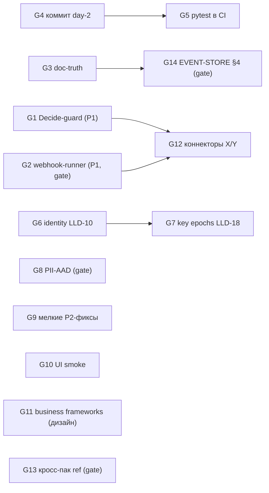

# DEVELOPMENT GRAPH — кандидаты работ с доказательствами

> Не roadmap-фантазия: каждый кандидат имеет evidence (файл:строка), desired outcome,
> зависимости, риск, blast radius, acceptance criteria, required reviewer и
> human-gate-метку. Актуализируется каждый цикл. Источник фактов: SYSTEM_TRUTH.md.

## Кандидаты

### G1 · Kernel: Decide перепроверяет guard HITL-перехода (D-010) — ✅ Cycle-003 ACCEPT
- **Проблема**: guard `when` проверяется только при Act-парковке; сумма может измениться, пока висит подпись.
- **Evidence**: workflow.go:146-153 (guard только в actCore) vs 347-358 (Decide: только `current != From`); D-010.
- **Desired outcome**: Decide отклоняет применение, если guard теперь false (GUARD_FAILED); каждый пак с HITL защищён ядром, а не ручными deny-строками.
- **Deps**: нет. **Risk**: medium. **Blast radius**: engine/workflow.go + tests.
- **Acceptance**: ✅ тест «сумма изменена после парковки → decide отклонён» (8 регрессий decide_guard_test.go); TestWorkflowReplay/GoldenReplay зелёные; dogfood finance/ap зелёные; Skeptic (ACCEPT-WITH-NOTES→учтено) + Security (ACCEPT) ✅.
- **Реализовано (Cycle-003)**: ре-оценка guard до журналирования решения (вариант A, D-013),
  контекст `$me` = requester, reject exempt, полная поверхность выражений (поля/computed/агрегаты/ref/часы);
  edge findTransition==nil логируется + метрика DecideFallbackSynthetic; deny-строки packs/ap — defense-in-depth.
- **Reviewer**: skeptic_pro + review_security_pro — оба ACCEPT. **Human gate**: нет (DSL не менялся).
- **Почему важно сейчас**: это P1-дыра в центральном механизме продукта (HITL-лестницы); packs/ap защищался вручную — каждый новый пак повторял бы ошибку.

### G2 · Kernel: webhook-раннер доставки (D-011)
- **Проблема**: `webhook out` журналирует TaskWebhook, но нода его не доставляет — интеграционный egress мёртв.
- **Evidence**: automation.go:290-294 (намерение); runner в cmd/kalita отсутствует (grep пуст); D-011.
- **Desired outcome**: runner ноды: доставка TaskWebhook (retries с backoff, таймауты, egress-whitelist доменов), статус-событие, egress-report.
- **Deps**: решение владельца о семантике egress-whitelist (trust boundary).
- **Risk**: medium-high (новый исходящий сетевой путь). **Blast radius**: новый cmd-файл + конфиг + тесты.
- **Acceptance**: задача доставляется с retry; недоступный URL → abandoned + эскалация; whitelist enforced; тесты + live-прогон.
- **Reviewer**: skeptic_pro + review_security_pro. **Human gate**: ДА — семантика egress-whitelist (какие домены/кто решает).
- **Почему важно сейчас**: «система Y» из сценария владельца остаётся декларацией без доставки.

### G3 · Doc-truth sync (8 STALE + 6 NOT IMPLEMENTED + 2 PARTIAL из 23 проверенных)
- **Проблема**: владелец не может доверять документации — README/SECURITY/V1-GATE/DSL-SPEC/EVENT-STORE/DSL-CORE-LIB/ROADMAP противоречат коду.
- **Evidence**: таблица Claims vs reality в SYSTEM_TRUTH.md (23 строки с вердиктами).
- **Desired outcome**: каждый документ либо приведён к коду, либо помечен статусом (draft/superseded); счётчики (tools, packs) генерируются/гейтятся.
- **Deps**: нет (кроме EVENT-STORE §4 — решение владельца, см. G14). **Risk**: low. **Blast radius**: docs/ + возможно один контракт-гейт.
- **Acceptance**: ноль STALE-утверждений в проверенных доках; README счётчики совпадают с `mcp contract`/файловой системой; Skeptic ACCEPT.
- **Reviewer**: skeptic_pro. **Human gate**: нет (правки доков; §4 помечается как open-question).
- **Почему важно сейчас**: задача владельца №1 — «не уверен, что понимаю систему»; понимание раньше разработки.

### G4 · Заморозка day-2 слоя (коммит)
- **Проблема**: 48 untracked + 23 modified файлов (71 «грязных» всего), включая производственный код (backup/anchor/TSA/trace/metrics/pii/erase/integrations/packs/ap/docs) — живут только в рабочем дереве.
- **Evidence**: git status --porcelain (аудит области 1); риск потери при переезде/сбое.
- **Desired outcome**: серия осмысленных коммитов; аудит .gitignore (.env, kalita-data/node.key не попадают).
- **Deps**: нет. **Risk**: low (локальные коммиты), но неправильный состав = утечка секретов.
- **Acceptance**: все производственные файлы закоммичены; секреты не в индексе; push — владельцем.
- **Reviewer**: владелец. **Human gate**: ДА — объём и состав коммитов, push.
- **Почему важно сейчас**: страховка всего, что построено.

### G5 · CI: pytest воркеров + тест inbound.py
- **Проблема**: агентский слой (15 pytest-файлов) вне CI; inbound.py без теста.
- **Evidence**: .github/workflows/ci.yml (только Go-шаги); workers/connectors/ — нет test_inbound.py.
- **Desired outcome**: pytest-джоба в CI (stdlib-only воркеры без внешних сервисов); тест inbound (secret/whitelist/idem).
- **Deps**: G4 (коммит). **Risk**: low. **Blast radius**: ci.yml + новый тест.
- **Acceptance**: CI зелёный с pytest; inbound покрыт; Skeptic ACCEPT.
- **Reviewer**: skeptic_pro. **Human gate**: нет (push — владельцем, gate общий).
- **Почему важно сейчас**: «тестами доказано» не выполняется для агентского слоя.

### G6 · Identity: LLD-10 PR-1/PR-2 (атомарный Register, инвайт-проекция)
- **Evidence**: registry.go:138-160 (lookup+Append без общего захвата); invites.go:101-129 (full-scan); тестов нет.
- **Desired outcome**: атомарная регистрация (TOCTOU закрыт), инвайты через проекцию O(1) с тестом Redeem.
- **Deps**: нет. **Risk**: medium (identity-ядро). **Blast radius**: internal/identity + тесты.
- **Acceptance**: race-тест регистрации; инвайт-проекция покрыта; все identity-тесты зелёные; Skeptic+Security ACCEPT.
- **Reviewer**: skeptic_pro + review_security_pro. **Human gate**: нет.
- **Почему важно сейчас**: «необратимые» пункты LLD, влияющие на многопользовательский пилот.

### G7 · Node key epochs (LLD-18 §2/§3)
- **Evidence**: checkpoint.go:61 (один nodePub); node.key_rotated отсутствует в event.go; верификация подписей — только текущим ключом (registry.go:414-429).
- **Desired outcome**: эпохи ключа узла, верификация по ключу-на-момент, upgrade-путь.
- **Deps**: нет (частично связано с G6). **Risk**: high (журнал/чекпоинты — schema_v-совместимость). **Blast radius**: eventstore+identity+cmd.
- **Acceptance**: ротация → старые чекпоинты верифицируются старым ключом; replay зелёный; GoldenReplay не тронут.
- **Reviewer**: skeptic_pro + review_security_pro. **Human gate**: возможно (изменение семантики verify).
- **Почему важно сейчас**: после пилота; сейчас — подготовить ADR.

### G8 · PII-AAD по LLD-16 ({event, field})
- **Evidence**: pii.go:111 (AAD = "kalita.pii:"+subjectID); поле можно перенести между полями субъекта.
- **Desired outcome**: привязка шифртекста к месту; миграция существующих ключей.
- **Deps**: нет. **Risk**: high (крипто-изменение; существующие данные). **Blast radius**: pii+records+erase.
- **Acceptance**: перенос поля не открывается; старые данные открываются (миграция); тесты.
- **Reviewer**: skeptic_pro + review_security_pro. **Human gate**: ДА (необратимая миграция ключей).
- **Почему важно сейчас**: security-долг; перед пилотом с чужими персданными.

### G9 · Мелкие фиксы P2 (verify panic, anchor-консистентность, 8 vs 10, retry-payload)
- **Evidence**: main.go:107 (panic на пустом журнале); backup.go:97-100 vs anchor.go:53-59; op.go:27 vs workflow.go:460; automation.go:476-484.
- **Desired outcome**: каждый пункт закрыт тестом или задокументированным решением.
- **Deps**: нет. **Risk**: low. **Blast radius**: точечные правки.
- **Acceptance**: регрессионные тесты; Skeptic ACCEPT.
- **Reviewer**: skeptic_pro. **Human gate**: нет.
- **Почему важно сейчас**: дешёвая коррекция честности системы (ops-слой).

### G10 · UI browser smoke-тесты
- **Evidence**: tests/webui_static_test.go:3 («No JS test runner exists»); UI-интерактивность непроверена.
- **Desired outcome**: минимальный браузерный smoke (meta→список→форма→inbox) в CI.
- **Deps**: нет (новая инфраструктура). **Risk**: medium. **Blast radius**: новый test-каталог + CI.
- **Acceptance**: smoke зелёный в CI; ломающий UI-фикс падает.
- **Reviewer**: skeptic_pro. **Human gate**: нет.
- **Почему важно сейчас**: UI — лицо продукта; после пилота.

### G11 · Business framework слой (дизайн, без кода)
- **Проблема**: нет архитектуры различения «знания LLM / curated frameworks / знание компании / deterministic rules».
- **Evidence**: отсутствует в коде и доках (PLATFORM-STDLIB — только механизмы).
- **Desired outcome**: дизайн-документ + классификация + первый curated-каталог (процессы/паттерны/KPI/вопросы владельцу).
- **Deps**: нет. **Risk**: low (документы). **Blast radius**: docs/forge + возможно packs/frameworks.
- **Acceptance**: дизайн принят architect_pro; Skeptic ACCEPT.
- **Reviewer**: architect_pro + skeptic_pro. **Human gate**: направление — владелец.
- **Почему важно сейчас**: durable IP Kalita = модель + бизнес-знания; закладывать рано, дёшево.

### G12 · Коннекторы X/Y для packs/ap
- **Deps**: G2 (доставка) для Y; ingress X — паттерн inbound.
- **Evidence**: packs/ap + workers/connectors/inbound.py (образец).
- **Reviewer**: skeptic_pro. **Human gate**: да (реальные системы — после пилота).

### G13 · Кросс-пак ref (счёт↔договор)
- **Evidence**: semantic.go:408-424 (только core.*/mdg/свои); H2 (Cycle-001).
- **Deps**: решение владельца о product boundary. **Risk**: high (компилятор+движок).
- **Human gate**: ДА — расширение DSL-философии.
- **Почему важно**: связность доменов — ядро «модели предприятия»; после пилота.

### G14 · EVENT-STORE §4: подписи агентов над мутациями — PRODUCT QUESTION
- **Evidence**: EVENT-STORE-v0.md:56 обещает; кода нет (только approvals/definitions/checkpoints).
- **Варианты**: (a) понизить документ (рекомендация Forge: подпись каждой мутации дорогая, HITL+WebAuthn уже дают non-repudiation для критичного); (b) реализовать (ADR + цикл ядра).
- **Human gate**: ДА — trust model.

## Dependency graph

## Выбор первых 3 циклов (Chief Architect, deepseek-v4-pro)

**Порядок ценности: понимание владельца > корректные границы > рабочий сценарий >
security/invariants > comprehensibility > tests > simplicity.**

1. **Cycle-002 «Doc-truth sync + P2-фиксы»** (G3 + G9) — ✅ завершён (ACCEPT).
2. **Cycle-003 «Decide перепроверяет guard»** (G1) — ✅ завершён (ACCEPT обоих
   reviewers; D-013).
3. **Cycle-004 «pytest в CI + inbound-тест»** (G5) — после HUMAN GATE G4 (коммит
   day-2 слоя, решение владельца). Reviewer: skeptic_pro.

G2/G8/G13/G14 — ждут решения владельца (gates). G6/G7/G10/G11 — после первых трёх.
