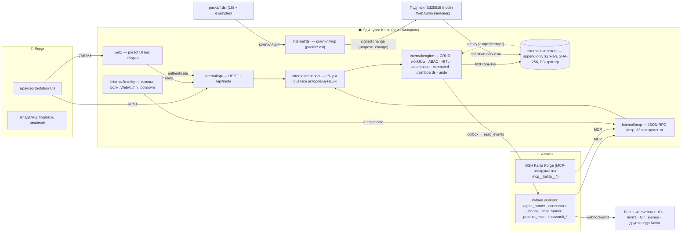

# SYSTEM MAP — архитектура Kalita простым языком

> Текущая архитектура по состоянию на 2026-07. Сверено с кодом (не с README).
> Детали компонентов: COMPONENTS.md. Путь бизнес→runtime: BUSINESS_TO_RUNTIME.md.

## Компонентная диаграмма

## Runtime-компоненты и их responsibility

| Компонент | Responsibility | Входящие | Исходящие |
|---|---|---|---|
| `web/` | Notation UI: из метаданных строит списки, формы, канбан, дашборды, approval inbox, agent-board | человек, `/api/meta` | REST-вызовы |
| `internal/api` | REST-сервер: CRUD/act/revert/rewind/diff, meta, портал-инвайты, healthz, metrics | браузер | transport → engine |
| `internal/mcp` | MCP-шлюз: 33 инструмента, токен→identity/роль, idempotency | агенты (воркеры, DSH) | transport → engine |
| `internal/transport` | Общая обвязка запросов (актор, basis, мутации) — parity REST↔MCP | api, mcp | engine |
| `internal/engine` | Вся бизнес-семантика: CRUD, workflow+HITL, ABAC, automation, computed, dashboards, undo/rewind | transport | eventstore (append), журнал (replay) |
| `internal/dsl` | Компилятор: packs → проверенные определения; ошибки {code,file:line,message,fix_hint} | packs/*.dsl | definition-события |
| `internal/eventstore` | Журнал: SHA-256 цепочка, PG/Mem, чекпоинты, эры, идемпотентность | engine | хранилище (PG) |
| `internal/identity` | Акторы: токены (O(1) index), пароли (bcrypt), WebAuthn, lockdown | api, mcp | журнал (акторы — тоже события) |
| `internal/pii`, `internal/secrets` | Шифрование полей (XChaCha20-Poly1305, шреддинг), секреты (файл 0600) | engine | журнал/файлы |
| `workers/*` | Агенты вне ядра: agent_runner, bridge, connectors, chat_runner, product_mcp, knowvault_* | MCP-инструменты | engine через MCP |
| `cmd/kalita` | CLI: serve, check, agent/user, verify, lockdown, backup, upgrade, mcp contract, … | оператор | всё выше |

## Основные data flows

1. **Запрос человека** (UI): браузер → `GET /api/meta` (поля/вкладки/доски из модели) → REST-вызов → transport → engine → валидация+ABAC → append-событие → проекция обновлена → UI перечитывает.
2. **Запрос агента** (MCP): token → identity/роль → JSON-RPC `tools/call` → transport → engine → те же проверки прав, тот же журнал. Байт-идентичность REST и MCP доказана parity-тестом.
3. **Изменение модели**: человек/агент → `propose_change` (паркуется) → человеческая подпись (Ed25519/WebAuthn) → definition-события в журнал → реплей → новая модель живая. Агент не может протолкнуть изменение без подписи.
4. **Automation**: Tick-цикл движка: schedule/event/stuck-триггеры → задачи (TTL-пул) → действия как события; ошибки журналируются (cap 5 retry → abandoned + задача человеку).
5. **Федерация**: нода A пишет события → `bridge` читает outbox (`read_events`) least-privilege ролью → эмитит на ноду B; exactly-once через детерминированные ключи `bridge|<node>|<seq>`. Синхронный RPC между нодами запрещён (конституционный гейт).

## Ключевой архитектурный факт

**Журнал — единственная правда.** Движок не хранит состояние: всё (записи, роли, права, токены, задачи,
shadow) — in-memory проекции, пересобираемые реплеем. Детерминизм fold'а проверен golden-реплеем и тестом
реплея на 1M событий. Всё, что происходит, — событие: «EverythingIsAnEvent» (тест).
