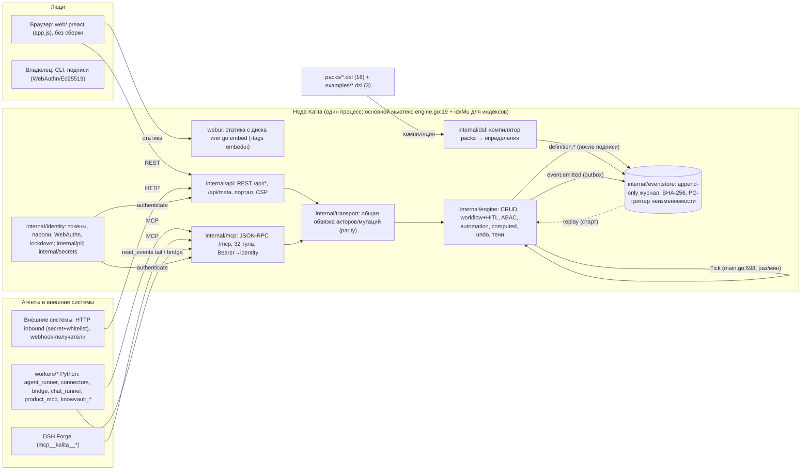

# SYSTEM TRUTH — каноническая модель существующей Kalita

> Главный документ для владельца. Только то, что СУЩЕСТВУЕТ СЕЙЧАС — не маркетинг,
> не future vision. Каждый факт — из кода/тестов (файл:строка), сверено аудитом
> 2026-07 (10 областей, Cartographer flash) и независимым Skeptic-обзором.
> Status актуализируется каждым циклом (фаза UPDATE SYSTEM TRUTH).

## Kalita in one page

**Kalita сегодня** — один Go-бинарник, который исполняет описание бизнес-системы:
пак (каталог `.dsl`-файлов) описывает сущности, workflow, роли/права, HITL-подписи,
автоматику, дашборды и UI; движок исполняет это описание напрямую (без генерации
кода); каждое действие — событие в append-only журнале с SHA-256 цепочкой; люди и
агенты бьют в один движок с одними проверками прав.

**Граница**: Kalita — ядро (DSL+движок+журнал+права+подписи) + паки (домены) +
Python-воркеры (агенты/интеграции) + notation-UI. Всё «агентское» вне ядра —
воркеры общаются с нодой через MCP как обычные сотрудники. LLM-интеллект и
agent-harness — заменяемые внешние слои.

**Что реально умеет**: компилировать DSL с агентскими ошибками `{code, file:line,
fix_hint}`; исполнять CRUD+workflow+ABAC(row/field/dashboard)+HITL(Ed25519/WebAuthn);
автоматику (schedule/stuck/event, retry cap 5); computed/агрегаты; undo/rewind;
журнал с реплеем (1M событий < 5с); 32 MCP-инструмента; UI без сборки; федерацию
двух нод через bridge-воркер; 16 паков + 3 примера; полный прогон go test ./... — зелёный
(348 PASS / 12 SKIP / 0 FAIL; ~348 test-функций; Cycle-003: guard Decide перепроверяется; RC: clean-room PASS).

## Architecture map (по реальному коду)

Ключевое: **журнал — единственная правда**; всё остальное (records, tasks,
approvals, actors, credentials, shadow, индексы) — in-memory проекции,
пересобираемые детерминированным реплеем (ADR-001).

## Component map

| Компонент | Responsibility | Source | Интерфейсы | Callers | Зависимости | Maturity |
|---|---|---|---|---|---|---|
| DSL compiler | компиляция packs→модель; закрытые ошибки E001–E062; миксины core.*; mdg | internal/dsl (13 файлов/4301 стр) | Compile, MergeModels, RenderPack, FieldTypes, ParseSchedule/ParseAggregate | cmd/kalita, engine (replay-компиляция), MCP | eventstore (таксономия) | 🟢 стабилен (spec frozen) |
| Engine | вся бизнес-семантика | internal/engine (30/7959) | Create/Update/Act/Decide/Revert/RewindTo/MetaFor/Tick/ReadEvents/Journal/ProposeChange/EmitEvent/EraseSubject/FlagIngest | api, mcp, cmd | dsl, eventstore, identity, pii | 🟡 в развитии |
| Eventstore | append-only журнал | internal/eventstore (9/1278) | Store (Append/All/Since/ByIdemKey/Verify), Seal/VerifyCheckpoints, Era | engine, identity, cmd | pgx (PG) | 🟢 стабилен |
| Identity | акторы, токены, WebAuthn, lockdown | internal/identity (7/1719) | Register/RegisterWithToken/Authenticate/VerifyApprovalAssertion/Lockdown/Password/Invites | api, mcp, engine | eventstore | 🟡 (LLD-10 PR-1/2, LLD-18 §2 не реализованы) |
| PII / Secrets | шифрование полей+шреддинг; секреты | internal/pii, internal/secrets | Seal/Open/Destroy; Loader | engine, cmd | x/crypto | 🟢 (PII-AAD слабее LLD-16) |
| REST API | поверхность для людей/UI | internal/api (14 src/1930 строк) | /api/* (роуты server.go:115-182), meta, portal, CSP | браузер, воркеры (bootstrap) | engine, identity, webui | 🟡 |
| MCP gateway | поверхность для агентов | internal/mcp (4 src/946 строк) | 32 тула (tools.go:39-101), contract | воркеры, DSH | engine, identity, transport | 🟡 |
| Transport | общая обвязка REST↔MCP | internal/transport | ActorFromInfo, MutationRequest, ActionRequest | api, mcp | — | 🟢 |
| WebUI | статика/embed UI | internal/webui, web/ (app.js 1109 стр, preact) | DirHandler, embed | cmd, браузер | — | 🟡 |
| SDK/UI-kit | React SDK + preact kit + storybook | packages/kalita-sdk, packages/kalita-ui, web/catalog | client.js, react.js, atoms/molecules/organisms | внешние интеграторы | — | 🟡 (двойной стек, TECHDEBT) |
| CLI | все подкоманды | cmd/kalita (serve/check/agent/user/verify/lockdown/backup/anchor/trace/logs/export/import/era/upgrade/product/report/egress-report/shadow/mcp) | флаги | оператор | всё | 🟡 (backup/anchor/TSA/trace untracked) |
| Workers | агенты/интеграции вне ядра | workers/* (Python, stdlib-only) | MCP-тулы, REST bootstrap | оператор/нода | kalita node | 🟡 (вне CI) |
| Packs | домены | packs/* (16) + examples/* (3) | .dsl | компилятор | core.* | 🟡 |
| CI | Go-проверки | .github/workflows/ci.yml | vet/build/test/golden/govulncheck/race/passport | GitHub | — | 🟡 (pytest/docker вне CI) |

## Runtime flows (entry → … → response, по коду)

### Flow A — Human CRUD через UI
Браузер → `GET /api/meta` (api/server.go:139 → handlers_ui.go:18 → engine.MetaFor
meta.go:107: поля/actions/board из модели, per-actor) → `POST /api/records/{entity}`
(server.go:369 → transport.MutationRequest → engine.Create records.go:89 →
createCore:108: basis-гейт → idem-проверка ДО валидации → ABAC `can` → валидация →
sealPII → store.Append → applyEvent (проекция) → ответ). Update: `PATCH` (server.go:144 →
updateCore records.go:429; workflow-поле писать нельзя — checkWorkflowField:403).
UI не содержит логики прав — только проекция meta.

### Flow B — Agent action через MCP
`POST /mcp` (mcp/server.go:90, JSON-RPC) → toolsCall:129 → authenticate:159
(Bearer → identity.Registry.Authenticate, tokenIndex O(1), constant-time) →
rate-limit 240/мин → dispatch (tools.go:122, 32 тула) → requireIdemKey (все
мутации) → engine.* → событие в журнал → writeToolResult. Тот же движок, что у REST
(parity-тест байт-идентичности, tests/transport_parity_test.go:239).

### Flow C — Workflow transition + approval + signature
`act` → engine.Act workflow.go:98 → actCore:116: checkConsistent → canAct →
findTransition → guard `when` через evalWhere (146-153, с computed-полями) →
shadow-гейт (LLD-09) → если `requires approval(Role)`: `approval.requested`
(171-181), статус `pending_approval`, состояние НЕ двигается. Решение: Decide:259 →
canApprove:279 → политика подписи 297-328 ((1) WebAuthn human_signature; (2)
`--require-human-signature` → SIGNATURE_REQUIRED для людей без passkey; (3) raw
sig + verifier; (4) `requireSig`) → **Cycle-003: ре-оценка guard на grant-пути ДО
журналирования решения (321-359: withComputed+ctxFor, $me = requester
`a.RequestedBy`, GUARD_FAILED → аппрувал остаётся pending, решение retryable;
reject-путь освобождён — D-009)** → applyTransitionAndEmit:456 (emits-планы
строятся ДО append; ошибка payload = атомарный откат; op-скобка) →
runAutoTransitions:505. Edge: findTransition==nil (переход удалён из DSL) —
legacy synthetic-переход без guard, логируется + метрика DecideFallbackSynthetic
(D-013).

### Flow D — Automation
Tick (нода раз в минуту, cmd/kalita/main.go:598) → automation.go:115: schedule
(daily-at гейт, dedup по bucket) / stuck → fireActions:205 (op-скобка при
каскадных действиях; каждая ошибка действия журналируется отдельно
`automation.failed`) → retry 1..16m, cap 5 → abandoned + escalation-задача роли
defApprover (412-438). Event-триггеры: dispatchEvent (events.go:291) из fireEmits;
create/update-триггеры: runEventTriggers (records.go:194/277/341/517) — НЕ из
act/Decide (документированный gap). Действия: create/update/emit (в движке),
agent/escalate/notify/webhook (задачи; webhook = только намерение — runner ноды
не существует).

### Flow E — External integration ingress
(a) MCP `emit_event` (грант emit, валидация payload по схеме события) — путь
bridge/коннекторов; (b) `POST /api/bootstrap` (self-registration воркеров,
shared secret, роли только из allowlist); (c) workers/connectors/inbound.py —
HTTP-приём untrusted payload: constant-time secret, whitelist field_map, создание
через MCP под least-privilege ролью, idem-ключ; (d) `flag_ingest` (периметр-сигнал);
(e) `search_perimeter` (RAG). Все входы — через те же движок и права.

### Flow F — External integration egress
event.emitted → outbox: `read_events` (engine/read_events.go:31, грант tail,
whitelist kinds — record-виды не отдаются) → bridge/subscribe (Python) доставляют
наружу; webhook/notify — журналируемые задачи-намерения (доставки нет — D-011);
`egress-report` сверяет самодекларации whitelist с egress.called-фактами;
product_mcp/chat_runner — pass-through под токеном вызывающего (своих credential нет).

### Flow G — Federation (Kalita→Kalita)
Существует на уровне воркеров: packs/site (роли BridgeReader tail / BridgeEmitter
emit, deny-строки на delete/create/update/act/emit/read) + workers/bridge (tail на ноде A → emit на ноде B;
exactly-once ключи `bridge|<node>|<seq>`; читает через read_events) +
workers/lib/subscribe.py (durable-подписки, DeadLetter, GovernedError).
Синхронный RPC между нодами запрещён конституционным гейтом
(deploy/federation-demo/check_no_sync_rpc.sh). В Go-ядре федерации нет (осознанно,
RELEASE-1.0). Демо: deploy/federation-demo/run.sh.

### Flow H — Journal replay → runtime restoration
engine.New (engine.go:185): store.All → schema_v-гейт (event > CurrentSchemaV=1 →
отказ старта) → applyEvent по kinds (255-468; definition-события компилируются
безопасно — двойной recover) → recoverUnclosedOps (незакрытая op-скобка →
op.aborted + Inconsistent + эскалация). Детерминизм: scheduleTaskHistory —
функция порядка fold, NoteAt из ev.TS, nextSerial из скана записей. Гейты:
TestGoldenReplay (замороженный журнал → точные проекции), TestReplayBudget1M
(1M < 5с).

## DSL capability matrix

| Capability | Syntax | Runtime | Tests | Пример | Status |
|---|---|---|---|---|---|
| pack header | `pack X / version / requires / depends` | merge.go (мульти-пак, коллизии) | compile_test.go | pangram | ✅ |
| entity (+singleton, label) | `entity Name ["Label"] [singleton]:` | records.go (singleton=1 запись) | engine_test.go | pangram | ✅ |
| constraints | `unique(a,b)` (композитный) | validate.go:293 | engine_test.go:243 | pangram | ✅ |
| roles (agent, rate, hours) | `Name [agent] [rate N] [hours N]` | E019/E031; report.go | compile_test.go | pangram | ✅ |
| permissions/ABAC | 13 verbs (read/create/update/delete/act/approve/full/deny/call/emit/tail/flag/erase), targets E/E.field/E.*/*/all + `where` | permissions.go (deny>allow, fail-closed), field-level (LLD-20), row-level where | abac_test, lld20_update_perms_test | pangram | ✅ |
| workflow | `workflow E on field:` + переходы: action, `auto`, `when`, `assignee=[agent(Role)]`, `requires approval(R)`, `label`, `emits` | workflow.go (guard→park→decide→apply; auto-цепочка hops<10; Cycle-003: guard перепроверяется в Decide) | workflow_test, decide_guard_test, events_test | ap (лестница) | ✅ |
| automation | `on schedule|stuck|event|create|update|delete:` + действия create/update/emit/notify/agent/escalate/webhook | automation.go (retry cap 5, schedule-dedup) | automation_test, automation_retry_test | pangram | ✅ (webhook = намерение; on update не из act) |
| events | `event Name:` + `emits Ev(args)` | events.go (валидация payload, dispatch, fold без ре-диспатча) | events_test.go:142 | site, ap | ✅ |
| subscriptions | `subscription:` + `on event` + `sink worker|endpoint` | только компиляция; доставка workers/lib/subscribe.py | subscription_test, test_subscribe.py | — | 🟡 (egress-whitelist не enforced) |
| integration (read-only коннекторы) | `integration:` + `read fn(params) -> tree|list` | api/callproxy.go:70, engine.CanCall | отдельного теста нет (грамматика: dsl/panic_test.go:138) | — | ✅ (в README не упомянут!) |
| product (white-label) | `product:` name/logo/color/home/auth | main.go:500-503, meta.go | product_test.go | knowvault | ✅ |
| product.mcp | `product.mcp:` tool in/compose/out (create/act/query) | workers/product_mcp (manifest/compose/facade) | product_mcp_test | contracts, knowvault | ✅ |
| include/миксины | `include core.Named/Assignable/Contact/Period` | semantic.go inline, core.go | include_test | — | ✅ (LLD-22) |
| link | `link A -> B as fwd / inv` | links.go (inverse авто) | links_test | pangram | ✅ |
| ui | list/filters/section/board | meta.go → web/ | golden_test.go, meta_test.go, webui_static_test.go | pangram | ✅ |
| dashboard | `tile "L": count|sum|avg|min|max … where/group by` | dashboard.go (ABAC на агрегатах) | dashboard_dogfood_test | pangram | ✅ |
| computed/агрегаты | арифметика, `sum/count/... where`, `days_since`, `business_*_since` | computed.go (fixpoint), aggregate.go (один парсер) | computed_*_test | finance | ✅ |
| типы (все) | string/text/int/float/money/bool/date/datetime/file/email/url/phone/duration/percent/color/decimal/json/serial + enum/ref/mdg/array[...] | validate.go; serial; files; calendar | pangram-тест всех типов | pangram | ✅ (geo — нет) |
| core.* | core.User (виртуальный), core.Calendar, mdg-словари | core.go, calendar.go | coreuser_test | все паки | ✅ (Department/справочники — нет) |
| PII | `pii`-поля, seal/open/shred | records.go sealPII, pii.go, erase.go | pii_test | — | ✅ (AAD слабее LLD-16) |
| i18n | label="..." | метки в meta | label_test | packs | 🟡 (рендер локалей не проверен) |

## Claims vs reality (сводка 23 проверенных утверждений)

> **Статус после Cycle-002 (doc-truth sync)**: все STALE-пункты ниже исправлены в
> самих документах (README: 32 tools/16 паков; SECURITY gaps закрыты; V1-GATE маркер;
> EVENT-STORE §1/§4/§5; DSL-SPEC §4/§5/§9/§10; DSL-CORE-LIB; PLATFORM-STDLIB;
> TYPE-SYSTEM; PORTAL-VISION; MCP-CONTRACT-v0 → SUPERSEDED; HLD/HLD-V1; ROADMAP;
> LLD-10/LLD-18 помечены planned→G6/G7). NOT IMPLEMENTED либо помечены в доках,
> либо оставлены открытым вопросом (§4 → G14, решение владельца). Таблица ниже —
> состояние ДО синхронизации (историческая фиксация аудита).

| Claim | Verdict | Суть (evidence) |
|---|---|---|
| «31 tools» (README:61,178) | STALE | кода 32; v1-контракт=32 и гейтится; README не гейтится |
| SECURITY P1#4–7, P2#8 «открыты» | STALE | WebAuthn/secrets/authfail/lockdown/shredding реализованы и покрыты тестами |
| EVENT-STORE §1 payload jsonb | PARTIAL | код: TEXT (pgstore.go:20-23 — jsonb ломает хэш), спека не обновлена |
| EVENT-STORE §4 «агент подписывает ВСЕ мутации» | NOT IMPLEMENTED | подписи только approvals/definitions/checkpoints; мутации — bearer-аутентификация |
| EVENT-STORE §5 «проекции в той же транзакции» | PARTIAL | проекции in-memory (ADR-001); атомарность через мьютекс |
| DSL-SPEC §4 reachability/конфликты auto-guards | NOT IMPLEMENTED | semantic_blocks.go проверяет только states/дубли |
| DSL-SPEC §9 rollback определений | NOT IMPLEMENTED | definition.reverted — мёртвая константа |
| DSL-SPEC §10 integration «reserved» | STALE | полностью реализован (parser.go:847-938) |
| TYPE-SYSTEM geo | NOT IMPLEMENTED | в scalarTypes нет; док сам себе противоречит |
| HLD «React» / «WASM» / «stdio MCP» | STALE / NOT IMPLEMENTED | preact+htm; wazero нет; stdio нет |
| MCP-CONTRACT-v0 (6 пунктов) | STALE | get_grammar/query/get_record/update/read_journal/idem — сигнатуры изменились |
| PORTAL-VISION self-registration «missing» | STALE | инвайт-регистрация работает (portal_test) |
| RELEASE-1.0 N1/N2/N7/N10 | VERIFIED | WebAuthn, ошибки=события, lockdown/shadow/report/egress — в коде+тестах |
| RELEASE-1.0 N8 «parity-тест» | VERIFIED | общий transport + tests/transport_parity_test.go:239 (байт-идентичность REST↔MCP); тест живёт в пакете tests/, а не в internal/transport |
| LLD-10 PR-1/PR-2 | NOT IMPLEMENTED | Register не атомарен; инвайты full-scan |
| LLD-16 PR-1/PR-2 | VERIFIED | шифр до журнала, хэш над шифртекстом (AAD — только subject) |
| LLD-18 §2 эпохи ключа узла | NOT IMPLEMENTED | node.key_rotated нет; один nodePub на чекпоинты |
| LLD-18 §3 ротация ключей акторов | VERIFIED | RotateKey + actor.key_rotated |
| LLD-21 subscription.failed | VERIFIED | workers/lib/subscribe.py (не ядро, как и задумано) |
| DSL-CORE-LIB §4 «миксинов нет» | STALE | include/миксины реализованы (LLD-22) |
| PLATFORM-STDLIB B2/B3/C | NOT IMPLEMENTED / PARTIAL | справочников нет; core.User есть, Department нет; Comment — механизм, не сущность |
| ROADMAP «10 паков» | STALE | 16 паков, все компилируются |
| V1-GATE чекбоксы | STALE | блокеры закрыты к rc1; документ не обновлён |

## Архитектурная классификация крупных capability

| Capability | Класс | Комментарий |
|---|---|---|
| DSL compiler, engine, eventstore, identity, pii | **KALITA CORE** | ядро — внутренние инварианты продукта |
| packs/* (16) + examples | **KALITA PACK** | домены; ядро доменов не знает |
| workers/agent_runner, connectors, bridge, subscribe, product_mcp, chat_runner, knowvault_* | **INTEGRATION RUNTIME** | транспорт/агенты вне ядра, общаются через MCP |
| perimeter (детектор), promptbox | **INTEGRATION RUNTIME** | защитный слой воркеров (не ядро) |
| web/, packages/kalita-ui | **KALITA CORE** (поверхность) | notation-UI — часть продукта, buildless |
| MCP-шлюз, REST | **KALITA CORE** (поверхность) | оба транспорта ведут в ядро |
| deploy/docker/upgrade/backup/TSA | **EXTERNAL INFRASTRUCTURE** (обвязка ноды) | операции вне семантики предприятия |
| DSH Forge / Harness | **AGENT HARNESS** | намеренно вне Kalita |
| Business frameworks (пока нет) | **BUSINESS FRAMEWORK** | curated-знания — не построены |
| definition.validated/reverted, projection.rebuilt, actor.role_changed (мёртвые kinds) | **LEGACY / CANDIDATE FOR REMOVAL** | не пишутся и не фолдятся нигде |
| core.reference/Department (заявлены, нет) | не классифицируется — отсутствует | см. PLATFORM-STDLIB |

## Технический долг — доказательный реестр

| Sev | Тип | Проблема | Evidence |
|---|---|---|---|
| P1 | SECURITY | setPassword без self/Owner-гейта — impersonation-класс | TECHDEBT.md:258-271; internal/api/login.go:23 (setPassword) |
| P1 | SECURITY | consumer-auth отсутствует | TECHDEBT.md:144 |
| P1 | MISSING CAPABILITY | webhook-доставка: задача есть, runner ноды нет | engine/automation.go:290-294 (намерение); cmd/kalita — runner отсутствует (D-011) |
| P1 | SECURITY | ~~guard HITL-перехода не перепроверяется в Decide (окно park→decide)~~ → **FIXED Cycle-003** (ре-оценка guard в Decide, workflow.go:321-359, + 8 регрессий decide_guard_test.go; D-013) | D-010 |
| P1 | SECURITY | ~~анти-prompt-injection на ingest — только трипвайр~~ → **FIXED Cycle-A5** (детектор + flag_ingest core-журналирование; block-vs-tripwire = KNOWN LIMITATION) | TECHDEBT.md:155-171 |
| P2 | BUG | ~~`verify` паникует на пустом журнале~~ → **FIXED Cycle-002** (verifyHeadSeq + тест) | cmd/kalita/main.go:107, verify_test.go |
| P2 | ARCHITECTURE | дублирующиеся лимиты вложенности 8 vs 10 (зафиксировано D-012: осознанное расхождение) | engine/op.go:27 vs workflow.go:460 + комментарии |
| P2 | ARCHITECTURE | retry-контекст не замораживает payload | automation.go:476-484 |
| P2 | ARCHITECTURE | ~~«anchor» в backup ≠ «anchor» в anchor-команде~~ → **FIXED Cycle-002** (единая семантика ev.Hash последнего checkpoint.sealed + тест) | anchor.go:45-92, anchor_test.go |
| P2 | BUG | verify читает только PG, а backup советует файл journal.jsonl | backup.go:136-137 vs main.go:89-94 |
| P2 | MISSING CAPABILITY | LLD-10 PR-1/PR-2: Register не атомарен, инвайты full-scan | registry.go:138-160; invites.go:101-129 |
| P2 | MISSING CAPABILITY | LLD-18 §2: эпохи ключа узла отсутствуют | checkpoint.go:61 (один nodePub) |
| P2 | SECURITY | PII-AAD = только subjectID (поле можно перенести) | pii.go:111 vs LLD-16 §1 |
| P2 | MISSING CAPABILITY | `on update`-триггеры не срабатывают после act-переходов | runEventTriggers только в records.go (194/277/341/517) |
| P2 | DOCUMENTATION | расхождения доков с кодом: 8 STALE, 6 NOT IMPLEMENTED, 2 PARTIAL (из 23 проверенных) | таблица Claims vs reality |
| P2 | ARCHITECTURE | CI не гоняет Python-воркеры (15 pytest-файлов) | .github/workflows/ci.yml (только Go) |
| P2 | MISSING CAPABILITY | UI без браузерных тестов | tests/webui_static_test.go:3 |
| P2 | BUG | inbound.py без теста | workers/connectors/ (нет test_inbound.py) |
| P2 | MISSING CAPABILITY | `kalita upgrade` неработоспособен из коробки (нет publish/cosign) | upgrade.go:108-111; ci.yml без release |
| P2 | SECURITY | `upgrade --insecure-skip-tls-verify` default true; prometheus insecure_skip_verify | upgrade.go:102; deploy/prometheus/prometheus.yml:15 |
| P3 | ARCHITECTURE | мёртвые kind-константы (definition.validated/reverted, projection.rebuilt, actor.role_changed) | eventstore/event.go |
| P3 | ARCHITECTURE | O(журнала) на супервизорные операции (lastMutation, recordStateAsOf, countActorEvents) | revert.go:388/329; tasks.go:299-312 |
| P3 | BUG | ~~erase.go использует time.Now вместо инъекционных часов~~ → **FIXED Cycle-002** (e.now() + тест) | erase.go:63, erase_test.go |
| P3 | DOCUMENTATION | .env.example не описывает KALITA_PG_DSN/KALITA_SECRETS_FILE | .env.example |
| P3 | ARCHITECTURE | dev-оверрайд knowvault с Windows-путём может утечь | deploy/knowvault/docker-compose.override.yml:7 |
| P3 | PRODUCT QUESTION | «agent подписывает каждую мутацию» (EVENT-STORE §4) — обещано, не реализовано | решение владельца: понизить док или реализовать |

## Что НЕ проверено аудитом (честно)

- Живой браузер/UI-скриншоты; pytest-прогон всех воркеров (запускался только
  test_subscribe.py — 7 passed); реальный Postgres/CI-прогон; federation-demo и
  docker-compose end-to-end; `kalita upgrade` с docker-демоном; бенчмарки.
- eval_questions.json прочитан частично (структура известна, содержимое — нет).
