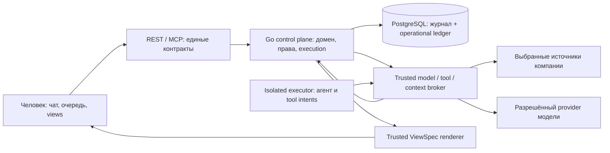

# Kalita Next — High-Level Design N1

**Статус:** целевая архитектура для планирования, 2026-10-07. Не описание готового продукта. Контракт: [PRODUCT_CONTRACT](PRODUCT_CONTRACT.md); текущее состояние: [AS_IS](AS_IS.md); решения: [DECISIONS](DECISIONS.md).

## 1. Назначение и выбор основы

Kalita — корпоративная среда, где человек управляет работой агентов на данных компании. Продукт соединяет понятные цели и ответственность, устойчивые рабочие кейсы, ограниченные действия, наблюдаемые результаты и подходящие представления. Сотруднику не нужно управлять сервером оркестрации или понимать каждый шаг LLM, чтобы работать. Компания должна иметь возможность объяснить и ограничить существенные действия.

Развиваем существующую Kalita. DSL, типизированные сущности/команды, ABAC, REST/MCP и журнал дают полезную основу. Текущий task pool, runner, границы внешних вызовов и metadata UI не считаются готовой реализацией новой среды. Они заменяются/расширяются по проверяемым контрактам, а не сохраняются ради слова «ядро». Полный rewrite сейчас лишает нас проверяемой основы и не подтверждён сравнением. Дефект конкретного подсистемного контракта не требует переписывать всё.

Платформа начинается с одной компании и процесса. Она встраивается в выбранные источники, сохраняет их авторитет и постепенно принимает владение теми решениями/процессами, которые компания явно передаёт. Универсальная схема всей организации, массовое копирование данных и одновременная замена старых продуктов не нужны для первого результата.

## 2. Контекст и границы доверия

Внешние участники: сотрудники, администратор/владелец процесса, корпоративные источники, поставщик модели и будущие контрагенты. Внутри: доверенный control plane и broker; недоверенный executor/model output; ограниченный UI renderer. Документ источника, ответ модели и созданная композиция — данные, а не инструкции управления платформой.

Диаграмма показывает логические роли, не обязательные отдельные микросервисы. Первый профиль упаковывает control plane, PostgreSQL, изолированный executor и broker в один поддерживаемый installation path. Внешний model provider означает разрешённую передачу выбранного контекста; локальная установка сама по себе не означает «данные никогда не покидают компанию».

Профили доверия: `managed/enforced` с проверенной технической изоляцией executor; `trusted adapter` с организационным доверием, без обещания принудительной блокировки прямого egress; `development` без production гарантий. Только первый профиль может обещать контроль всех платформенных вызовов. Интеграционный connector входит в trusted computing base в пределах своего контракта и не становится произвольным plugin с credentials.

## 3. Компоненты и обязанности

| Компонент | Ответственность | Не является |
|---|---|---|
| Domain contracts | Типы, переходы, условия принятия, named commands | Универсальной онтологией компании |
| Contract authoring | DSL и будущие редакторы переводят в canonical typed contracts | Единственным языком всех агентов/UI |
| Identity / policy service | Actor, company issuer, текущий ABAC, grants, risk policy | Ролью из prompt |
| Work service | WorkCase, обязательства, ответственность, основания, принятие | Историей чата |
| Execution adapter | Run/Attempt/lease/fence, таймеры, cancel/retry, bounded delegation | Вторым источником бизнес-фактов |
| Broker | Проверка context/tool/model requests; credentials; intent/receipt | Исполнителем произвольного кода модели |
| Integration registry | SourceBinding, mapping, freshness, ACL, action contracts | Готовым набором всех ERP adapters |
| View service / renderer | Проверка и показ композиции, pin/share/snapshot, trusted confirmation | Исполнением HTML/JS из ответа агента |
| Experience registry | MethodRevision, применимость, тесты, владельцы, отзыв | Общей памятью сырых prompts |
| Operations | Установка, health, costs, backup/restore, compatibility, support export | Только первым запуском бинарника |

Точные контракты находятся в [LLD](README.md). REST и MCP вызывают один application service layer. Нельзя создать удобный агентский transport, обходящий права, budget или журнал.

## 4. Модель работы и базовый поток

Цель имеет владельца и критерии; WorkCase сохраняет работу независимо от интерфейса. Обязательство, принятие ответственности, исполнение и оценка результата различаются. Для простого случая owner и критерий могут быть полями кейса; выделяем самостоятельные сущности только для независимого жизненного цикла/прав.

1. SourceBinding читает выбранный материал с текущими правами, сохраняет Observation с внешней версией, временем и границей полноты.
2. Агент предлагает Claim/кандидат обязательства. Человек либо отклоняет, либо подтверждает точные условия. Подтверждённое решение становится доменным событием.
3. Ответственный запускает работу с разрешённым методом, grant, общей ресурсной границей и закреплёнными версиями. Execution adapter выдаёт Attempt с lease/fence.
4. Модель через broker получает минимальный разрешённый context и предлагает typed intents. Broker проверяет актуальные права/лимиты. Действие с последствием проходит policy-specific approval или заранее ограниченный grant.
5. До внешнего вызова сохраняются Effect и reservation; после вызова — receipt или `unknown`. Report модели не завершает внешний эффект сам.
6. Результат и Evidence предъявляются уполномоченной стороне; Acceptance отдельно фиксирует решение по конкретным критериям.
7. UI agent предлагает ViewSpec для этой задачи. Представление можно закрепить/поделиться/сохранить snapshot по разным контрактам. Проверенная версия метода может стать опытом с ограниченной применимостью.

Дочерняя работа сужает выдаваемые полномочия. Дополнительное specialist-полномочие возможно по отдельному разрешённому company issuer edge, а не саморасширению родителя. Родитель получает лишь разрешённый результат, не весь приватный контекст specialist.

## 5. Источники истины и транзакции

| Данные | Авторитет | Производные / восстановление |
|---|---|---|
| Первичные ERP/CRM/mail записи | Выбранная внешняя система до явной передачи | Локальные observations с версиями/временем; не обещают актуальность |
| Принятые доменные изменения в Kalita | Append-only business journal | RAM projections, индексы и UI; rebuild не вызывает effects |
| Run, Attempt, Grant, reservations, Effect, idempotency | Operational SQL ledger | Execution read models; не восстанавливаются только из business projections |
| Версии определений/методов/политик | Версионированный registry и принятые события публикации | Compiled contracts / cache |
| ViewSpec, аудитория, snapshot metadata | Версионированное хранилище с ACL и публикационными событиями | Rendered UI не authoritative |
| Secrets | Защищённый secret store / разрешённый KMS | В событиях лишь references; отдельный restore plan |

В baseline используется bounded PostgreSQL execution adapter. Новый **Tx API** должен в одной транзакции менять operational state, записывать нужное canonical journal event и outbox. Business mutation, выполняемая внутри шага, фиксируется в той же транзакции либо как отдельная идемпотентная команда с явно описанной промежуточной стадией; нельзя назвать пару несвязанных commits атомарной. Outbox доставляет уже принятое событие в projections/notifications после commit; он не заменяет атомарность ledger + canonical event.

Текущий `Store.Append` не обеспечивает композицию с будущими таблицами. Это новая инженерная задача. Порядок блокировок: root budget/authority → упорядоченные domain aggregate/run → step/effect → attempt → journal head lock → journal/outbox write. Все затронутые append paths приводятся к совместимому порядку; отдельный pool connection/nested Append внутри Tx запрещён. Projection failure после commit не меняет решение; dedup по event ID и replay восстанавливают чтение. Durable aggregate/authority heads обновляются в Tx вместе с journal. If-Match/guards/ABAC и protected reads проходят applied-head barrier; отстающая RAM projection не может разрешить действие старому owner. До catch-up — bounded wait или projection_not_ready/fail closed. Сеть не вызывается под DB lock.

I00 проверяет прототип отказами и сравнивает с Temporal. При провале PG gate требуется новый ADR, пересмотр ownership scheduling/history и согласования с PG budget/effect authority. В одном deployment один adapter; automatic failover между двумя master не предусмотрен.

## 6. Инварианты N1

| ID | Обязательное свойство |
|---|---|
| N-01 | WorkCase, условия и принятие ответственности переживают смену чата, модели и UI |
| N-02 | Каждый context/read/mutation/dispatch проверяет актуальную company authority и scope; derived data не обходят ACL |
| N-03 | Недоверенный executor не получает долгоживущих secrets, DB и произвольной сети в enforced profile |
| N-04 | Общий бюджет учитывает дочерние runs, retry, calls и unknown reserves атомарно; business impact limits отдельно |
| N-05 | Stale Attempt не завершает работу после перевыдачи; receipt реального эффекта сохраняется trusted reconciliation независимо от старого executor |
| N-06 | Intent предшествует внешнему dispatch; `unknown` сохраняется и блокирует blind retry; cancel/rollback не означают unsend |
| N-07 | Claims, observations, evidence, acceptance и измеренная полезность не подменяют друг друга |
| N-08 | Версии исполнения и основания сохраняются; изменения semantics проходят явную миграцию, replay не повторяет effects |
| N-09 | Agent-generated view проходит trusted schema/ACL/catalog validation; подтверждение существенного действия строится доверенным кодом |
| N-10 | MethodRevision имеет владельца, применимость, отрицательные тесты, срок/отзыв и права переноса |
| N-11 | Backup/restore/upgrade охватывают operational ledger и внешние расхождения; restore начинается в quarantine |
| N-12 | Установленный профиль, границы гарантий и полнота наблюдения видимы; ценность и простота подтверждаются реальными сценариями |

Для hard monetary budget broker резервирует доказуемый верхний предел вызова: ограниченный input/output, duration/число requests, закреплённая pricing revision и provider-side caps. Неизвестный billable outcome удерживает worst-case reserve. Провайдер без проверяемого bound поддерживается только как явно обозначенный soft estimate с независимым административным пределом; не включается в hard-budget mode. Недокументированные тарифы не принимаются как нулевая цена. Actual > reserve — инцидент, блокирующий новые calls и требующий проверки контракта, а не тихое превышение.

## 7. Отказы, отзыв и восстановление

Падение до commit не создаёт active operation; падение после commit восстанавливает очередь из ledger/outbox. Потеря lease останавливает новые вызовы executor, но не доказывает, что внешний effect не произошёл. Потеря ответа провайдера/системы создаёт `unknown` и сохраняет ресурсный резерв до reconciliation.

Revocation запрещает будущие действия. Порядок локального dispatch permit и revoke фиксируется в Tx; запрос, пересёкший permit boundary до revoke, может уже уйти в сеть. Это известное ограничение, а не обещание нулевой гонки внешнего мира. Невозможность проверить текущую authority ведёт к fail closed для side effect.

Restore стартует в quarantine: claims, effects и автоматизации выключены, предыдущие executor tokens не действуют. Backup может потерять уже отправленные effects и поздние revocations, которых вообще нет в восстановленной базе. Устанавливаем потерянный хвост через доступный WAL/anchor/remote receipts, заново подтверждаем текущие роли/grants и источник истины; необъяснимый диапазон остаётся blocked. Новый dispatch epoch выдаётся только после gate. Восстановление файла базы само по себе не возобновляет полномочия.

## 8. Представления и опыт

Генеративный интерфейс — часть целевой парадигмы. UI agent выбирает композицию, группировки, визуализацию, inline actions и варианты для личности/команды, опираясь на versioned catalog. Выразительность растёт через доверенные компоненты и их contracts. Нельзя ограничить развитие одной таблицей, но нельзя исполнять непроверенный код из model output.

Pinned view — сохранённая композиция/запрос к текущим данным с текущими правами. Shared view проверяет аудиторию, literals и provenance приватного контекста до публикации. Snapshot — отдельная фиксированная копия с самостоятельным доступом/retention; уже скачанный экспорт нельзя отозвать. Универсальный одинаковый экран не требуется.

Опыт накапливается как проверенные MethodRevision и reusable pack contracts, а не как бесконтрольная общая память. Улучшение метода проверяется на исходных, новых и отрицательных случаях, имеет owner и expiry; модель может предложить новую редакцию, но не объявить её production автоматически. Экономическая польза измеряется отдельно от числа удачных исполнений.

## 9. Поставка и расширение

Релизы [R0–R7](delivery/RELEASES.md) сначала закрепляют контракты и безопасное исполнение, затем проверяют ценность первого процесса, UI, опыт и эксплуатацию. Первый value probe может использовать шаблонные views; коммерческая готовность требует полного поддерживаемого пути, а delegated-work experiment — отдельного доказательства.

После повторяемости первого pack выбирается следующая вертикаль. Передача владения процессом/полями оформляется AuthorityTransition: scope, момент, old/new writer, reconciliation, ручной fallback. Только один authoritative writer на область; shadow comparison не пишет. Федерация и machine-first предприятия исследуются после воспроизводимого владения одной областью, а не до первого покупателя.

Решения, которые ещё требуют evidence: первая компания и источники, удобный deployment, runtime gate, величины RPO/RTO/нагрузки и метрики полезности. Они вынесены в I00 с владельцами; прочие инварианты не ждут ответа рынка.
